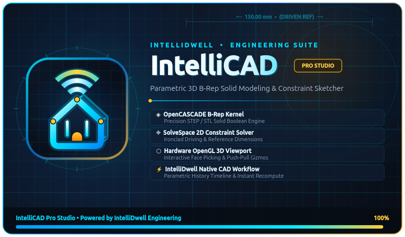

<p align="center">
  
</p>

<h1 align="center">IntelliCAD — Parametric 3D CAD Studio</h1>
<p align="center">
  <b>Powered by IntelliDwell Engineering Suite • Native Linux / Ubuntu 3D CAD</b><br/>
  <i>Proprietary Evaluation Release — Download & Try Out</i>
</p>

<p align="center">
  <a href="https://github.com/TannerNelson16/IntelliCAD/releases/latest">
    
  </a>
  
</p>

---

## 🚀 Quick Download & Try It Out (Ubuntu / Linux x86_64)

1. **Download the latest release package** from the [**Releases Page**](https://github.com/TannerNelson16/IntelliCAD/releases/latest) (`IntelliCAD-v1.0.0-Linux-x86_64.tar.gz`), or run in your terminal:

```bash
curl -L -o IntelliCAD-v1.0.0-Linux-x86_64.tar.gz \
  https://github.com/TannerNelson16/IntelliCAD/releases/download/v1.0.0/IntelliCAD-v1.0.0-Linux-x86_64.tar.gz
tar -xzf IntelliCAD-v1.0.0-Linux-x86_64.tar.gz
cd IntelliCAD
./install.sh
```

2. **Launch IntelliCAD**:
   - Run `./run_intellicad.sh` from the extracted folder, **or**
   - Launch **IntelliCAD** directly from your Ubuntu / Linux Applications menu!

---

## ✨ Key Features

- **Welcome Hub & Interactive Step-by-Step Tutorials**:
  - Start a blank project, open an existing `.icad` / `.step` / `.stl` design, follow 4 interactive guided tutorials (with **"✨ Auto-Perform Step (Show Me)"**), or explore 5 built-in 3D sample projects.
- **2D Parametric Sketching & Ironclad Constraints**:
  - Draw 2-Point Rectangles, Center Rectangles, Circles, 3-Point Arcs, Elongated Slots, Regular Polygons, Ellipses, Lines, 2D Corner Fillets, and Parametric Text.
  - **Sketch Patterns**: Create **Grid / Rectangular Patterns**, **Revolve / Circular Patterns** (with interactive canvas center picking), and **Linear / Angled Patterns** with live ghosted previews.
  - **Fusion 360-Style Dimensions**: Hover & highlight sketch geometry or 3D body edges, place driving dimensions that automatically resize geometry without overwriting earlier constraints, or add gray reference `(driven)` dimensions when fully constrained.
- **Direct 3D Solid Modeling & Graphical Surface Selection**:
  - Click any planar 3D body surface directly to **Extrude (Join/Cut)**, **Revolve**, **Sweep**, **Loft**, **Shell**, **Rib**, or **Emboss** without needing a separate sketch first.
  - **Graphical Hole & Thread Placement**: Click any 3D face to place **Simple**, **Counterbore**, or **Countersink** holes with **ISO Metric Threads (`M3`–`M20`)** and real 3D helical V-groove thread modeling.
  - **3D Edge Fillet & Chamfer**: Click edges directly in the 3D viewport with sequential fallback and explicit conflict diagnostics when opposing fillets overlap.
- **Parametric History Timeline & CAD I/O**:
  - Roll back, step forward, or double-click any feature in the bottom timeline to edit parameters in place.
  - Save/Load `.icad` projects and Import/Export industry-standard **STEP (`.step`)**, **BREP (`.brep`)**, and **STL (`.stl`)** files for 3D printing.

---

## ⌨️ Keyboard & Mouse Shortcuts

| Shortcut / Action | Function |
| :--- | :--- |
| **`Shift + Middle Mouse Drag`** | Orbit 3D Camera |
| **`Middle Mouse Drag`** | Pan Camera |
| **`Mouse Wheel`** | Zoom toward cursor |
| **`S`** | Open floating Shortcut Tool Search Palette |
| **`F`** | Zoom to Fit all 3D bodies |
| **`L` / `R` / `C` / `D` / `P`** | Sketch Line / Rectangle / Circle / Dimension / Project Edge |
| **`Esc`** | Exit active tool & clear selection |
| **`Ctrl + Z` / `Ctrl + Y`** | Undo / Redo sketch action or roll timeline |

---

## 📄 License

**Proprietary Software — Copyright © 2026 Tanner Nelson / IntelliDwell. All Rights Reserved.**  
Provided in binary form for personal evaluation and testing only. See [`LICENSE`](LICENSE) for full terms.
